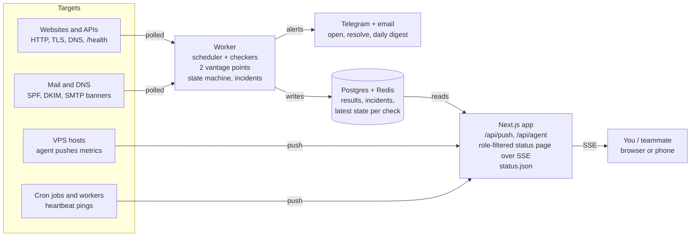

# Health Check System — Build Plan

Oct 29, 2026 · @Shayan

## Goal & scope

Build **Pulse** (working name): one self-hosted Next.js page that shows, for every deployed service and website, whether it is up, how fast it answers, when its TLS/domain expires, and the latest errors — refreshed every 30–60 s, with alerts to Telegram when something breaks.

**In scope (v1)**

- External checks: HTTP(S) status + latency, keyword/JSON assertions, TLS expiry, domain expiry, DNS records, TCP ports, SMTP/IMAP banners
- Push heartbeats: cron jobs and BullMQ workers ping Pulse; silence = down
- Host agent on each VPS: CPU, RAM, disk, systemd units, Docker containers, recent error lines from journald/Docker
- Error feed: the `errors` field of each app's `/health` endpoint plus agent log tails (no Sentry — none of the remaining targets use it)
- Two roles: **ADMIN** (you) sees every target; **USER** (teammate) sees Roco targets only
- History: 90-day uptime bars, latency sparkline, incident log
- Alerts: Telegram bot (primary), email (fallback)

**Out of scope (v1)**: full log aggregation (Loki/ELK), APM tracing, public status page for clients, roles beyond ADMIN and USER, Sentry integration.

**Constraint that shapes everything**: you're in Turkey and some targets sit behind Iranian or Cloudflare networks — checks must run from **at least two vantage points** (e.g. HostVDS VPS + a second VPS or Cloudflare Worker) so one network path failing isn't mistaken for an outage.

## Target inventory

The first build task is a `targets.yaml` registry; this is the starting list from known projects — confirm URLs and add anything missing before Phase 1.

| Target | Host / platform | Checks | Error source | Visible to |
| --- | --- | --- | --- | --- |
| client.rocobroker.ir (client portal) | 89.46.217.245 · Ubuntu | HTTP + login page keyword, TLS, `.ir` domain expiry, from 2 vantage points | App `/health` | USER + ADMIN |
| rocobroker.com (main site) | 89.46.217.221 · host1 | HTTP 200 + keyword, TLS, domain, DNS | App `/health` errors (added in Phase 5) | USER + ADMIN |
| roco-seo agents | 31.57.24.70 · Ubuntu | Heartbeat per scheduled run, `/health` | App errors | USER + ADMIN |
| Roco email (SPF/DKIM/DMARC, SMTP) | LiquidWeb + providers | DNS TXT assertions, SMTP banner on 587/465 | Bounce webhook (later) | USER + ADMIN |
| termspace site | Next.js, host not decided | HTTP for `/ar`, `/en`, `/fa`, TLS | — | ADMIN only |
| HostVDS VPS (95.182.96.28) | Debian | Host agent, SSH port, Xray/V2Ray unit, nginx unit, TLS on WS endpoint | journald | ADMIN only |
| Ubuntu VPS (shared with teammate) | Ubuntu | Host agent, Docker containers | journald / Docker | USER + ADMIN |
| AlmaLinux cPanel server | cPanel | HTTP, TLS, disk via cPanel API or agent | cPanel error log | USER + ADMIN |

The V2Ray row deliberately checks **nginx + TLS on the WebSocket path**, not just the port — the earlier incident where nginx died and clients fell back to plain connections would be caught by a TLS-handshake check, not by a TCP check.

## Architecture

A single worker actively checks what can be reached from outside; hosts, cron jobs and queues push their own signals in, so nothing needs inbound ports and silence itself becomes an alert.



The worker writes results and opens incidents; the Next.js app serves both the ingest endpoints and the status page, streaming state from Redis over SSE, filtered by the viewer's role.

## Check types

Each check is a small TypeScript module implementing one interface, so new kinds plug in without touching the scheduler.

```ts
interface CheckResult { status: 'up' | 'degraded' | 'down'; latencyMs?: number; message?: string; meta?: Record<string, unknown> }
interface Checker<C> { kind: string; run(cfg: C, signal: AbortSignal): Promise<CheckResult> }
```

| Kind | How | Down when | Degraded when | Default interval |
| --- | --- | --- | --- | --- |
| `http` | `undici` request, follow ≤3 redirects | timeout, 5xx, wrong status, keyword missing | latency > threshold, 4xx where 2xx expected | 60 s |
| `json` | `http` + JSONPath assertions on `/health` body | assertion fails or `status != ok` | any `checks[*].status == degraded`; non-empty `errors[]` feeds the error list | 60 s |
| `tls` | `tls.connect`, read `valid_to`, issuer, SAN | expired, hostname mismatch | expires < 14 days | 6 h |
| `domain` | RDAP (fallback `whois` for `.ir`) | expired | expires < 30 days | 24 h |
| `dns` | `dns.promises.resolve*` vs expected | record missing / wrong | — | 15 min |
| `tcp` | `net.connect` | refused / timeout | connect > 1 s | 60 s |
| `smtp` | read banner, `EHLO`, check STARTTLS | no banner | no STARTTLS | 5 min |
| `heartbeat` | target `POST /api/push/:token` | no ping within `grace` | ping carries `status=fail` | passive |
| `agent` | host agent pushes metrics + last error log lines every 30 s | agent silent > 90 s, unit/container down | disk > 85 %, RAM > 90 %, load > cores×2 | passive |
| `queue` | Redis: BullMQ `getJobCounts()` (roco-seo, if it uses BullMQ) | Redis unreachable | waiting > N, failed rising | 60 s |

**Standard `/health` contract** for your own apps (add during Phase 5): `GET /health` → `{ status, version, uptimeS, checks: { db, redis, queue, vendorX: { status, latencyMs, error? } }, errors: [] }`, protected by a shared token header. This is what turns a blind HTTP 200 into real dependency-level visibility.

## Data model & retention

PostgreSQL (Drizzle ORM) holds config mirror, results and incidents; Redis holds the latest state per check for instant page loads and SSE fan-out.

| Table | Key columns | Notes |
| --- | --- | --- |
| `targets` | id, name, group, audience, tags, env | audience = roco or admin; synced from `targets.yaml` on boot (YAML is source of truth, in git) |
| `checks` | id, target_id, kind, config jsonb, interval_s, timeout_ms, vantage[] | One target has many checks |
| `check_results` | check_id, vantage, ts, status, latency_ms, message | Partitioned by month; index (check_id, ts desc) |
| `results_hourly` | check_id, hour, up_ratio, p50, p95, n | Rollup job every hour; feeds 90-day bars |
| `incidents` | id, check_id, opened_at, resolved_at, cause, last_message | Opened/closed by the state machine, not by raw results |
| `heartbeats` | token, check_id, last_ping_at, grace_s | Token is the push URL secret |
| `host_metrics` | host, ts, cpu, mem, disk jsonb, units jsonb, containers jsonb | Latest 24 h raw, then hourly rollup |
| `error_events` | source, external_id, target_id, title, count, last_seen | Upserted from /health payloads and agent log tails |
| `users` | id, email, password_hash, totp_secret, role (ADMIN or USER), telegram_chat_id | USER queries are filtered to audience = roco server-side, in every API route and the SSE stream |

**Retention**: raw results 14 days, hourly rollups 400 days, incidents forever. A nightly job drops old partitions — no `DELETE` scans.

**Volume check**: ~40 checks × 1/min × 2 vantage points ≈ 115k rows/day ≈ 1.6M rows in 14 days — trivial for Postgres on the core VPS.

## Dashboard page

One route, `/`, readable in 3 seconds: a banner that says "All systems operational" or "2 down, 1 degraded", then everything grouped, problems sorted to the top.

1. **Top banner** — overall state *for the targets this user can see*, count of open incidents, last refresh time, live dot (SSE connected).
2. **Problems strip** — only rendered when something is red/amber: target, failing check, since when, last error message, vantage points that agree.
3. **Groups** — **Roco Broker** (client portal, rocobroker.com, roco-seo, email) is visible to both roles. **Personal & client projects** (termspace) and the HostVDS proxy VPS render only for ADMIN; the rest of **Infrastructure** (Ubuntu VPS, cPanel server) is visible to both roles. For a USER, admin-only targets are absent from the HTML and the API, not just hidden. Each target is a row: status pill, name, p95 latency, 90-day uptime bar (one cell per day, hover = %), TLS/domain days-left badges, error count.
4. **Row expand** — per-check list, 24 h latency sparkline per vantage, last 10 results, latest errors from `/health` and agent log tails, host metrics for VPS rows (disk/RAM bars, systemd units, containers).
5. **Incidents tab** — table, newest first: target, opened, duration, cause, resolved; filtered by role like everything else.

UI rules: dark default, shadcn/ui + Tailwind, `prefers-reduced-motion` respected, no client polling — SSE pushes state diffs. Works on a phone, since alerts will usually be opened from Telegram on mobile. Also expose `GET /api/status.json` so other tools (and a future Telegram `/status` command) read the same data.

## Alerting & incident logic

An incident opens only when a check fails **3 consecutive times from a majority of vantage points**, and closes after **2 consecutive passes** — this kills flapping and single-path network noise.

- **State machine per check**: `up → suspect → down → recovering → up`; `degraded` is tracked separately and only alerts if it lasts > 15 min.
- **Vantage disagreement** (one says down, other says up) → show as `degraded` with label "regional", no page. Logged so you can see patterns like `.ir` endpoints unreachable from outside.
- **Channels**: Telegram bot is primary (open, resolve, daily 09:00 digest of TLS/domain expiries and degraded items); email via SMTP only as fallback when Telegram delivery fails.
- **Routing by role**: each user links their Telegram chat once (`/start <code>` from their profile page). ADMIN gets every alert; USER gets alerts for the targets they can see.
- **Dedup & mute**: one message per incident (edited in place on resolve), `maintenance` windows in YAML, `/mute <target> 2h` command (ADMIN only).
- **Watchdog for the watcher**: Pulse itself sends a heartbeat to an external free monitor (Healthchecks.io or a Cloudflare Worker cron). If Pulse dies, you still hear about it.

## Deployment & security

Run the core on a dedicated fresh Ubuntu VPS (217.60.38.195) as one Docker Compose stack; run a second, stateless probe elsewhere so the page never depends on a single network path.

- **Compose services**: `web` (Next.js standalone), `worker` (scheduler + checkers + alerting), `postgres:16`, `redis:7`, `caddy` (TLS, reverse proxy). Named volumes for Postgres; nightly `pg_dump` to off-box storage.
- **Second vantage**: same `worker` image in `PROBE_ONLY=1` mode on HostVDS, posting results to `POST /api/ingest` with an HMAC-signed token. (Alternative: a Cloudflare Worker cron doing HTTP/TLS checks only.)
- **Host agent**: tiny Node or Go binary + systemd unit on each VPS, outbound-only push to `/api/agent` — no inbound ports opened. Read-only access to the Docker socket via a socket proxy (`tecnativa/docker-socket-proxy`), never the raw socket.
- **Access — two roles**: Auth.js credentials + TOTP for both accounts. `ADMIN` sees and manages everything; `USER` (teammate) sees `audience = roco` targets only, read-only. Authorization lives in one `scopeTargets(user)` function used by every query, API route and the SSE stream, with tests asserting a USER never receives an `audience = admin` target. Users are created by ADMIN via a seed/CLI command — no public sign-up.
- **API**: `status.json` behind a per-user token, filtered by that user's role. Not publicly indexed (`noindex`, no public DNS name advertised).
- **Secrets**: `.env` only on the server, never in `targets.yaml`; health tokens scoped read-only.
- **Outbound hygiene**: checker User-Agent `PulseMonitor/1.0`, timeouts ≤ 10 s, max concurrency 10 — so you never look like an attack to Cloudflare/WAFs in front of rocobroker.com.

## Phased build plan for Claude Code

Six phases, each one a separate Claude Code session ending in a commit, a passing test run and a manual check — about 7–10 working days solo. Don't start a phase until the previous one's verification passes.

1. **Phase 0 — Scaffold & inventory** (½ day)
   - pnpm monorepo: `apps/web`, `apps/worker`, `packages/core` (types, checkers), `packages/db` (Drizzle). Compose file, `.env.example`, `targets.yaml` with the inventory above, each target tagged `audience: roco | admin`.
   - Verify: `docker compose up` brings all services healthy; `pnpm typecheck` clean; YAML validates against a Zod schema that rejects a target without `audience`.
   - Rollback: nothing deployed yet.
2. **Phase 1 — Checkers + scheduler** (1–2 days)
   - Implement `http`, `json`, `tls`, `domain`, `dns`, `tcp`, `smtp`. Scheduler on BullMQ repeatable jobs, one queue, concurrency 10, jitter ±10 %.
   - Verify: Vitest unit tests per checker against a local fixture server (200, 500, slow, bad cert via `mkcert`, expired cert); CLI `pnpm check <target>` prints results for every real target.
   - Rollback: worker is read-only against targets; stop the container.
3. **Phase 2 — Storage, state machine, incidents** (1 day)
   - Results into partitioned table, Redis latest-state, hourly rollup, incident open/close logic with the 3-fail / 2-pass rule.
   - Verify: test that simulates fail-fail-fail-pass-pass and asserts exactly one incident opened and closed; rollup matches raw aggregates.
   - Rollback: Drizzle migrations reversible; keep `down` migrations.
4. **Phase 3 — Auth, roles, dashboard** (2 days)
   - `users` table, Auth.js credentials + TOTP, ADMIN/USER roles, `scopeTargets(user)` applied to pages, API, SSE; CLI to create users. Then the Next.js page per the design above, SSE endpoint, `status.json`.
   - Verify: Playwright logged in as USER sees only USER-visible targets and gets 403/empty for an admin target's API URL and SSE events; as ADMIN sees all groups. Kill a fixture target → row turns red within 3 min. Lighthouse ≥ 90 on mobile.
   - Rollback: web container is stateless; redeploy previous image tag.
5. **Phase 4 — Telegram alerts, heartbeats, second vantage** (1 day)
   - Telegram bot with per-user chat linking and role-based routing, email fallback, push endpoint, probe-only mode on HostVDS with HMAC ingest, external watchdog ping.
   - Verify: stop a Roco fixture → one message to both users, edited to resolved on recovery; stop an admin-only fixture → message to ADMIN only; block the probe's network → "regional", no alert; stop Pulse → watchdog alerts.
   - Rollback: `ALERTS_ENABLED=false` flag.
6. **Phase 5 — Host agent, queues, `/health` in your apps** (2 days)
   - Agent binary + systemd unit + install script with journald/Docker error tail; BullMQ queue checker; add the `/health` contract (with an `errors[]` field) to the client portal and roco-seo.
   - Verify: fill a test disk to 86 % → degraded; `systemctl stop xray` on HostVDS → incident (ADMIN only); a forced error in the client portal's `/health` shows in its row within 2 min for both roles.
   - Rollback: `systemctl disable pulse-agent`; `/health` routes are additive and can be left in place.

**Production rule** for every phase that touches a live app (Phase 5): branch → staging/preview deploy first → verify → merge. Never edit nginx/Xray configs from this project; the agent only reads.

## Kickoff prompt

`CLAUDE.md` sits at the repo root. Start each phase in plan mode with this prompt:

```text
Read CLAUDE.md and docs/PLAN.md. We are on Phase <N>.
First: inspect the repo state and PHASE_<N-1>_NOTES.md, then propose a task list for this phase
only, with the files you'll create or change and how you'll verify each item. Wait for my OK.
After OK: implement, run the phase's verification steps from PLAN.md, fix failures,
then write PHASE_<N>_NOTES.md and commit with message "phase <N>: <summary>".
```

For Phase 1, fan out with subagents: one checker per subagent against the shared `Checker` interface, then a final review pass. For Phase 5, give Claude Code each app repo separately and require a PR per app.

## Open questions

- [ ] Host for the termspace site — not decided yet; add it to `targets.yaml` once deployed
- [x] Core stack VPS → 217.60.38.195, fresh Ubuntu VPS
- [x] USER sees the Ubuntu VPS and cPanel server → yes
- [x] Teammate gets dashboard access → two roles, ADMIN and USER
- [x] Sentry beyond Sunday Car Deals → no; Sentry dropped from v1
- [x] Primary alert channel → Telegram
- [x] Client/personal projects → same page, ADMIN only; USER sees Roco projects
